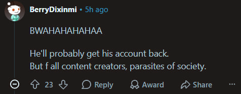

I believe in the US they call it 'Keeping up with the Joneses', and boy do I have a bunch of Joneses.

Today's topic though - Aion 2 [^happy_hamster_picture]

[^happy_hamster_picture]: 

They did drop the first raid, and the first (the first legit) banwave of RMTers, and one 'public figure' got into the crosshairs.[^xeno_reddit_thread]

[^xeno_reddit_thread]: [reddit link](https://www.reddit.com/r/Aion2/comments/1xnjzp9/aion_2_content_creator_got_banned_live_for_rmt/)

But given the comments about this, I started wondering - why are people happy? Not that they should be sad, but why do they cheer about it?

Before proceeding, a few definitions, so we're on the same page:

:::definition[to RMT]
to RMT = to obtain the in-game currency via 3rd-party websites like g2g using real-world money
:::

:::definition[to P2W]
to P2W = to obtain the in-game currency via the official exchange using real-world money
:::

# Out of Scope

I frankly don't care about how Xenosysvex is perceived - liked or disliked, or how he behaved during RMT'ing.[^behaving]

[^behaving]: Though some bits will be used later

So comments like this are not what I don't understand:

I'll be focusing more on the positive feelings people exhibit when one gets whacked with the ban hammer.

# The original problem I was having an issue with

Given the game's mechanics, I label that game P2W. Making a definition of what exactly is a P2W game is surprisingly hard, but I'd assume this game is far to one side, so for any line drawn in the sand, it's gonna be on the P2W side for an absolute majority of the Western playerbase. [^why_p2w_is_fine]

[^why_p2w_is_fine]: I have nothing against P2W; play whatever you like

One of the reasons, but not the only one, is the ability to buy in-game currency with real-life money, where the exchanger of goods is the developer itself.

So why is it a problem when, instead of the developer being the intermediary, it's now a g2g fella or whatnot?

Which means I don't get why people think that.

# Why is RMT bad?

- Support of stolen accounts and credit cards

Heard only once in passing. Straight up, nobody gives a damn.[^absence_of_source] And even then, though absent official data, a wild hunch which I trust - the Western audience uses Steam, not the Purple launcher, so this problem should be addressed by Valve, not game developers. And the reasons to use the Purple launcher are rather TOS-unfriendly anyway. [^why_purple]

[^absence_of_source]: source = I made it up, but I believe it

[^why_purple]: Easier to hand over to g2g'ers to farm pets

- Support of the developer

Every cent spent on g2g is one cent taken away from NCSoft. And some players prefer to support the product they enjoy via in-game purchases.[^support_via_ingame]

[^support_via_ingame]: Hamari et al. (2017), [Why Do Players Buy In-Game Content?](/papers/why-do-players-buy-in-game-content/)

- RMT hunt handicaps everybody

Since NCSoft is highly interested in shutting down RMT for its own financial sake, they impose gathering captchas, gathering timeouts, marketplace restrictions[^marketplace_restrictions], etc. Those restrictions harm everybody.

[^marketplace_restrictions]: The incentive of putting the marketplace behind a subscription can be interpreted in two ways

- G2G facilitates inflation

Done either via incentivized duping/hacking or via botting dungeons/mob drop farming.

- Bots forcing gathering players out of business

Bot gatherers drive the price of gatherable resources down, pushing away the players from the game, which can drive them away.

 
 

None of this is solved by a banwave. The restrictions will stay, the bots will return. The gatherers become happy for a while, but the end recipients of crafts will be the victims of increased prices.

Some of the reaction can still be explained. A public ban scares off other potential buyers, and some people are just glad the rules got enforced. 

But that explains relief, not happiness. Nobody's game got noticeably better the day Xeno got banned, and yet Reddit is hella happy. Something else is going on, and I think a part of it is envy.

# Why happy though?

While thinking about it, I came across this wonderful paper, which states (paraphrased): "People punish someone who treated them unfairly, but bystanders mostly don't, and what bystanders feel is envy of the cheater's gain rather than moral anger." [^pedersen]

[^pedersen]: Pedersen, Kurzban & McCullough (2013), [Do Humans Really Punish Altruistically?](/papers/do-humans-really-punish-altruistically/)

And my wheels started turning. In a game we play, we abide by the TOS, therefore people who break it are transgressors, and people who don't but do witness it are bystanders. [^reasoning_bystanders]

[^reasoning_bystanders]: This hinges upon the fact that players are indeed bystanders, but they are not, as the reasons why RMT is bad do affect them. However, any single RMTer's effect on any player is so marginal, they're equal to bystanders

Imagine playing Aion 2 and witnessing a person actively RMT'ing - the feeling that I experienced wasn't of morality, but of envy. And this paper supports it.

And in addition to that, people who weren't behind financially [^financially_assumption] felt much less envy.

[^financially_assumption]: and I'd argue in terms of in-game progression

But the paper relates to the people who get away with breaking the rules. What would happen to those who are caught?

Sounds a bit akin to schadenfreude, doesn't it? The feeling of joy in another person's troubles is a legitimate human emotion. 

But why does envy become schadenfreude? And also what if I just dislike the guy? Apparently there's also a paper for that - malicious envy predicts pleasure at their misfortune.[^vandeven]

[^vandeven]: Van de Ven et al. (2015), [When Envy Leads to Schadenfreude](/papers/when-envy-leads-to-schadenfreude/)

Moreover, in another paper, they've compared the emotions associated with a cheating student who's either a high achiever or an average achiever and who got caught. [^feather] People were more pleased about the downfall of a high achiever.

[^feather]: Feather (1989), [The Fall of the Tall Poppy](/papers/fall-of-the-tall-poppy/)

Can we equate a high achiever in an educational setting to a person who has a high item level, though? Or, conversely, can one equate a high achiever in an educational setting to a streamer, who's perceived to be high-status? That's an assumption I'm making.

Additionally, yet another paper claims that bystanders want a high-status wrongdoer punished harder than a low-status one. [^lin]

[^lin]: Lin et al. (2024), [The Effect of Wrongdoer's Status on Observer Punishment Recommendations](/papers/wrongdoer-status-and-observer-punishment/)

Here, though, we make another assumption: that the act of wrongdoing is not following the TOS, which we (TOS-abiding players) stick to. Therefore, breaking something we play by makes it a wrongdoing.

 

This one is gonna be a stretch, but hear me out.

There's a paper which takes a look at income levels and spending on loot boxes in video games - not related. [^close]

[^close]: Close et al. (2021), [Are High-Spending "Whales" Wealthy Gamers or Problem Gamblers?](/papers/loot-box-whales/)

And another one which takes a look at wealth levels and making in-game microtransactions - not related. [^meschik]

[^meschik]: Meschik et al. (2026), [Heavy Spenders in Digital Games](/papers/heavy-spenders-in-digital-games/)

Which leads me to believe there's a strong possibility that income/wealth is not significantly associated with in-game spending. [^cant_find_paper]

[^cant_find_paper]: Can't find anything on adults and general in-game spending, though

But would a person think that? I, for one, was surprised by that. I've always thought that if a person P2Ws more than me[^i_dont]. 

[^i_dont]: I don't P2W, but still

Then this person must be richer, therefore higher-status in real life, which feeds into the earlier papers.

 

And now straight up unsubstantiated tomfoolery:

In my observation of the world, people tend to say the reason a person is higher status than them is because they've cheated. And in P2W games it's impossible to know if a person's swiping or not. Would a person assume that another player, who is higher item level than them, is P2W'ing? 

If they indeed assume that, then any player unrelated to them, who is higher item level than them, would yield them pleasure if they get banned for RMT.

 
 

So yeah, that's my read on Xenosysvex's ban, cya